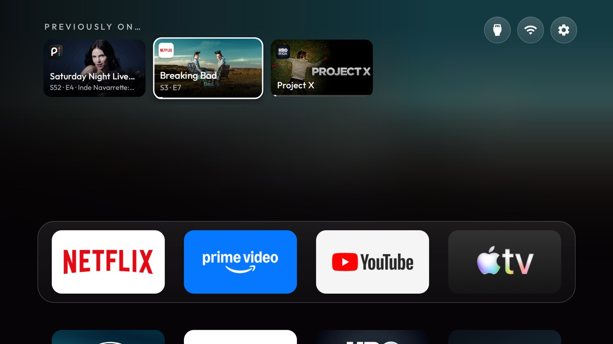

# JackHowa/cleanyourtv (`my-tv`): Continue watching on a clean, clock-free Home

A fork of [Gathin23/cleanyourtv](https://github.com/Gathin23/cleanyourtv) for a TCL S551G. It puts the
Continue watching row from [burnhamrobertp's fork](https://github.com/burnhamrobertp/cleanyourtv/blob/ac1fff7bf8f391c7da6337dfc251671f4df20420/FORK.md)
(itself built on [gwiersma](https://github.com/gwiersma)'s row) onto today's upstream launcher, with a header
that has no clock, date or greeting. Feature request upstream: [#4407](https://github.com/Gathin23/cleanyourtv/issues/4407).



**Tested on:** TCL S551G (US S5; G10, `G10_4K_US_NF`), Google TV 12, `STT2.230203.001`, launcherx disabled.
Prime Video, Netflix, Peacock, Max, Disney+ and Apple TV publish Watch Next rows there; every poster is `https://`.

## What it adds on top of upstream

- **Continue watching row** (`continue_watching` on in `config.xml`), captioned **"Previously On…"**: the system's
  Watch Next table, one card per show with its season, episode and a progress bar, engaged in the last 7 days.
  **Still artwork only: nothing autoplays.** OK opens the app at that title. burnhamrobertp's commits are kept as
  they were.
- **`continue_backdrop`** (`config.xml` or a theme): what fills the screen behind a focused card. `none` (dark,
  default), `heavy` (the poster reduced to its colours and a smooth gradient, in `shelf`), `soft` (a lighter blur),
  `blur` (the shelf's app-art wash) or `poster` (the poster itself). The apps here publish one poster per row and
  no `thumbnail_uri`, so the backdrop is episode art only when the app's poster is (Peacock's SNL is).
- **Real posters, launcher still offline.** [`addons/posters`](addons/posters/) (9 KB, no screen) holds `INTERNET`
  and serves posters to apps signed with its own key; without it, cards show the app's banner.
- **`show_clock`** (upstream PR [#4399](https://github.com/Gathin23/cleanyourtv/pull/4399)): `false` hides the
  clock and date and keeps the buttons at the top. The **`shelf`** theme uses it with the cinematic top shelf.
- **`cinematic_last_opened`** ([#4409](https://github.com/Gathin23/cleanyourtv/issues/4409)): `false` leaves the
  shelf's "Last opened" line out.

## Permissions beyond upstream

`READ_TV_LISTINGS` for the launcher, to read Watch Next rows (see [`docs/watch-next.md`](docs/watch-next.md)), and
`INTERNET` for the posters add-on only. The launcher itself still has no network access.

## Build and install

Build both on the same machine so they share a signing key, then install as upstream describes:

```bash
TV_HOST=<tv ip> launcher/build-and-install.sh
cd addons/posters && sh gradlew assembleRelease && cd ../..
```

Then push and `pm install -r` the add-on's APK as in [`addons/README.md`](addons/README.md), and
`tools/theme.sh themes/shelf` for the look in the screenshot.
